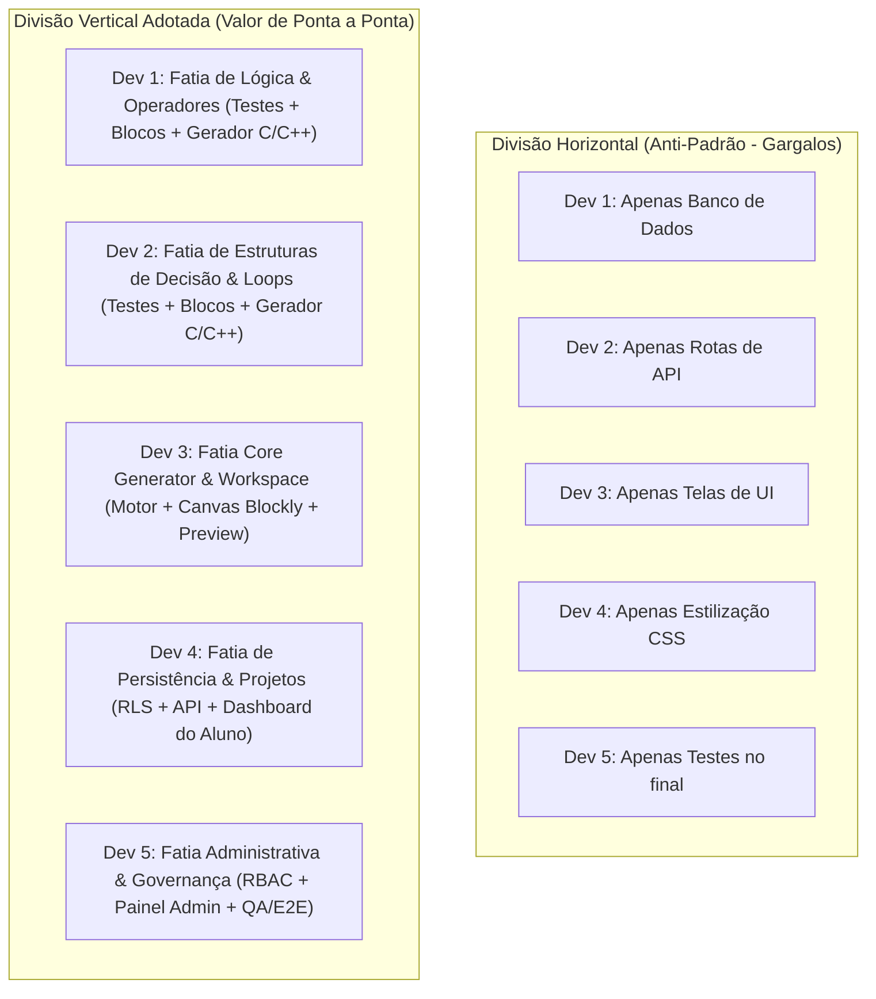
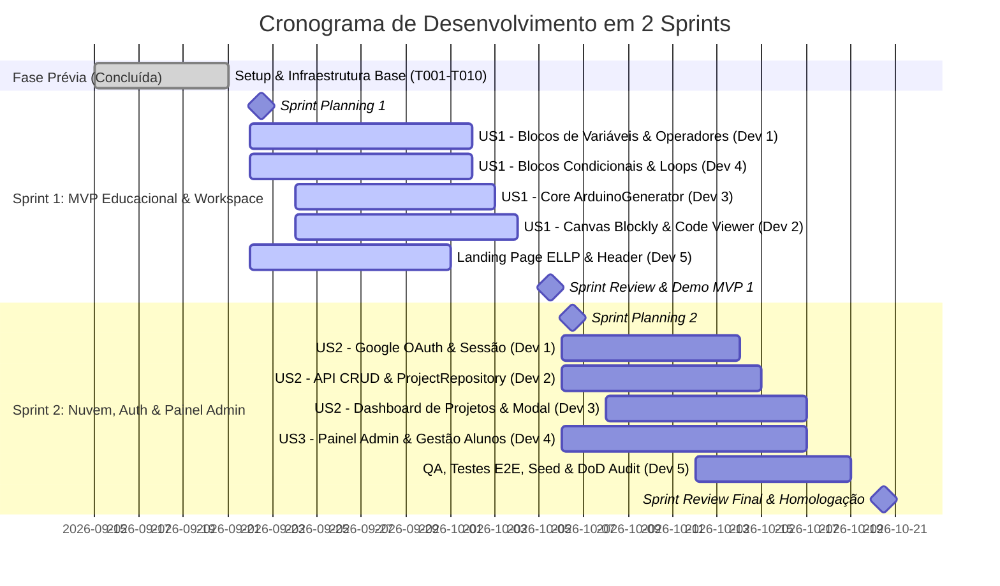
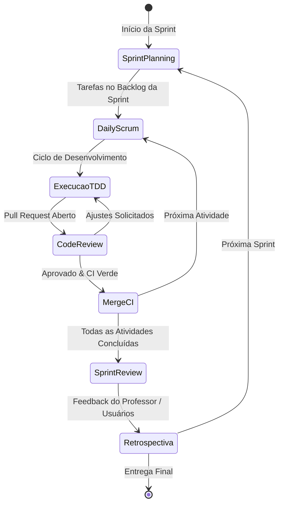

git # Plano de Projeto e Divisão de Trabalho Ágil (Scrum)

## Plataforma Web Educacional — Code Blocks Arduino

> **Disciplina:** Oficina de Integração 2 (ES47C / IF66K)  
> **Projeto Vinculado:** Extensão Universitária ELLP (Ensino Lúdico de Lógica e Programação) — UTFPR  
> **Repositório:** `Oficina-integracao/code-blocks-oficina`  
> **Metodologia:** Scrum com Fatiamento Vertical (_Vertical Slicing_)  
> **Tamanho da Equipe:** 5 Desenvolvedores  
> **Ciclo de Entrega:** 2 Sprints

---

## 1. Contexto Acadêmico e Visão do Produto

### 1.1 Contexto e Justificativa Pedagógica

A plataforma **Code Blocks Arduino** é uma solução educacional voltada a estudantes iniciantes em lógica de programação e robótica básica (ensino fundamental, médio e anos iniciais do ensino superior). No aprendizado de programação para microcontroladores (como a plataforma Arduino), um dos principais obstáculos é a **transição cognitiva** entre o raciocínio puramente conceitual e a sintaxe formal de linguagens textuais como C/C++.

O sistema mitiga essa barreira ao oferecer um ambiente visual interativo baseado no **Google Blockly**, permitindo que o aluno construa algoritmos conectando blocos visuais e visualize simultaneamente, em tempo real (< 1s), a tradução limpa e determinística para o código em **C/C++ compatível com a IDE do Arduino** (funções `setup()` e `loop()`).

### 1.2 Objetivos do Projeto

1. **MVP Pedagógico (Sprint 1):** Prover uma área de trabalho (_Workspace_) responsiva e fluida com blocos de fundamentos lógicos (variáveis, operadores aritméticos/lógicos, condicionais e repetições) e geração dinâmica de C/C++ determinístico.
2. **Ambiente Completo em Nuvem (Sprint 2):** Disponibilizar autenticação unificada via Google OAuth, persistência e carregamento individual de projetos salvos no Supabase com isolamento rigoroso via _Row Level Security_ (RLS), e um painel de administração (_Admin Dashboard_) com controle de acesso baseado em papéis (_RBAC_) para acompanhamento e autorização de turmas pelo professor.

---

## 2. Metodologia: Scrum com Divisão Vertical (_Vertical Slicing_)

### 2.1 Por que Divisão Vertical em vez de Horizontal?

Tradicionalmente, muitas equipes acadêmicas cometem o erro da **divisão horizontal em camadas** (um desenvolvedor faz apenas banco de dados, outro faz apenas APIs, outro faz apenas tela e outro faz testes). Esse modelo gera gargalos graves:

- O frontend fica bloqueado esperando o backend;
- O backend cria modelos sem saber se atendem à experiência do usuário;
- A integração final ocorre na véspera da entrega, gerando bugs em cascata;
- A autoria individual e a rastreabilidade ficam difíceis de auditar pelo professor.

No **Fatiamento Vertical (_Vertical Slicing_)**, cada desenvolvedor é responsável por uma **fatia completa de ponta a ponta** de uma funcionalidade:
$$\text{Fatia Vertical} = \text{Testes Automatizados (TDD)} + \text{Regra de Domínio} + \text{API / Integração} + \text{Interface (UI)} + \text{Validação}$$

### 2.2 Benefícios para a Avaliação Acadêmica

- **Autoria Individual Auditável:** Cada aluno da equipe possui commits, PRs e issues sob sua responsabilidade direta em todas as camadas (backend, frontend e testes), cumprindo as exigências da disciplina e da Constituição do projeto.
- **Entregas Parciais Funcionais:** Em qualquer momento da sprint, cada funcionalidade concluída está pronta para ser executada e demonstrada para o professor.
- **Risco Reduzido:** Caso surja alguma dificuldade técnica pontual em uma funcionalidade, as demais continuam integráveis e funcionais.

---

## 3. Composição da Equipe e Atribuição de Papéis

A equipe é composta por **5 desenvolvedores**, cada um assumindo uma especialização vertical e uma função no modelo Scrum:

| Desenvolvedor | Papel no Scrum                     | Especialidade Técnica no Projeto | Responsabilidade Principal                                                                                   |
| :------------ | :--------------------------------- | :------------------------------- | :----------------------------------------------------------------------------------------------------------- |
| **Dev 1**     | **Scrum Master** & Full-Stack Lead | _Core Logic & Auth Flow_         | Gestão dos ritos ágeis; blocos de variáveis e operadores; fluxo de autenticação Google OAuth.                |
| **Dev 2**     | **Tech Lead** & Frontend Architect | _Workspace UX & Project APIs_    | Arquitetura do Workspace, container Blockly reativo; APIs CRUD de projetos e contratos de persistência.      |
| **Dev 3**     | **Full-Stack Developer**           | _Engine Assembly & Dashboard_    | Montagem do compilador/gerador `ArduinoGenerator`; Dashboard de projetos e interface de salvamento.          |
| **Dev 4**     | **Full-Stack Developer**           | _Control Flow & Admin RBAC_      | Blocos de controle (Condicionais e Loops); painel administrativo de gestão de alunos com controle de acesso. |
| **Dev 5**     | **QA Lead & DevOps**               | _Design System, CI & Polish_     | Identidade visual/Landing page institucional; testes E2E, seed e garantia do _Definition of Done_ (DoD).     |

> _Nota:_ Na entrega presencial, os nomes dos integrantes do grupo devem ser associados aos papéis (Dev 1 a Dev 5) no cabeçalho do documento.

---

## 4. Planejamento das Sprints: Visão Macro

---

## 5. Detalhamento da Sprint 1: MVP Educacional (Workspace & Motor C/C++)

### 5.1 Objetivo da Sprint 1 (_Sprint Goal_)

> _"Entregar a área de trabalho interativa e independente (Workspace), permitindo que qualquer aluno monte algoritmos visuais utilizando blocos de variáveis, operadores, condicionais e repetições, com tradução instantânea (< 1s) para código Arduino C/C++ determinístico e formatado, além de estabelecer a identidade institucional da plataforma."_

### 5.2 Divisão Vertical de Tarefas por Desenvolvedor na Sprint 1

#### 👨‍💻 Dev 1 (Scrum Master & Core Logic Lead) — Fatia: Variáveis e Operadores

| Issue ID       | Atividade / Descrição                                    | Tipo   | Arquivos Afetados                        | Critério de Aceite                                                                                             |
| :------------- | :------------------------------------------------------- | :----- | :--------------------------------------- | :------------------------------------------------------------------------------------------------------------- |
| **#11 (T011)** | Testes unitários para blocos de variáveis                | Teste  | `tests/unit/generator/variables.test.ts` | Testes escritos primeiro (TDD), cobrindo declaração, atribuição e tipos `int`, `float`, `boolean`, `String`.   |
| **#16 (T016)** | Implementar definições Blockly e geradores de variáveis  | Código | `src/core/generator/blocks/variables.ts` | Blocos funcionais no Blockly gerando sintaxe válida de variáveis em C++. Teste T011 passa com 100% de sucesso. |
| **#12 (T012)** | Testes unitários para operadores aritméticos e lógicos   | Teste  | `tests/unit/generator/operators.test.ts` | Testes para operadores `+`, `-`, `*`, `/`, `>`, `<`, `==`, `!=`, `&&`, `\|\|`, `!`.                            |
| **#17 (T017)** | Implementar definições Blockly e geradores de operadores | Código | `src/core/generator/blocks/operators.ts` | Blocos geram expressões matemáticas e booleanas determinísticas com precedência de parênteses correta.         |

#### 👨‍💻 Dev 4 (Full-Stack Developer) — Fatia: Estruturas de Controle (Decisão e Loops)

| Issue ID       | Atividade / Descrição                                      | Tipo   | Arquivos Afetados                           | Critério de Aceite                                                           |
| :------------- | :--------------------------------------------------------- | :----- | :------------------------------------------ | :--------------------------------------------------------------------------- |
| **#13 (T013)** | Testes unitários para blocos condicionais (`if` / `else`)  | Teste  | `tests/unit/generator/conditionals.test.ts` | Casos de teste para `if` simples, `if/else` e condicionais aninhadas.        |
| **#18 (T018)** | Implementar definições Blockly e geradores de condicionais | Código | `src/core/generator/blocks/conditionals.ts` | Blocos geram blocos `if (...) { ... } else { ... }` formatados e indentados. |
| **#14 (T014)** | Testes unitários para blocos de repetição (_loops_)        | Teste  | `tests/unit/generator/loops.test.ts`        | Casos de teste para repetição por contagem (`for`) e por condição (`while`). |
| **#19 (T019)** | Implementar definições Blockly e geradores de repetição    | Código | `src/core/generator/blocks/loops.ts`        | Blocos produzem loops `for` e `while` em C++ com escopo seguro de variáveis. |

#### 👨‍💻 Dev 3 (Full-Stack Developer) — Fatia: Motor Compilador (_ArduinoGenerator Engine_)

| Issue ID       | Atividade / Descrição                                | Tipo   | Arquivos Afetados                                | Critério de Aceite                                                                                                           |
| :------------- | :--------------------------------------------------- | :----- | :----------------------------------------------- | :--------------------------------------------------------------------------------------------------------------------------- |
| **#15 (T015)** | Testes unitários de integração do `ArduinoGenerator` | Teste  | `tests/unit/generator/arduino-generator.test.ts` | Validação de esqueleto Arduino, divisão de variáveis globais, função `setup()`, função `loop()` e descarte de blocos órfãos. |
| **#20 (T020)** | Implementar classe principal `ArduinoGenerator`      | Código | `src/core/generator/arduino-generator.ts`        | Classe que herda de `Blockly.Generator`, agregando os blocos criados e emitindo o sketch completo em C/C++.                  |
| **#21 (T021)** | Definir configuração da _Toolbox_ de blocos          | Código | `src/core/generator/toolbox.ts`                  | Configuração XML/JSON da barra lateral do Blockly, agrupando categorias por cores e ícones lógicos.                          |

#### 👨‍💻 Dev 2 (Tech Lead & Frontend Architect) — Fatia: Componentes do Workspace

| Issue ID       | Atividade / Descrição                                            | Tipo       | Arquivos Afetados                                | Critério de Aceite                                                                                                              |
| :------------- | :--------------------------------------------------------------- | :--------- | :----------------------------------------------- | :------------------------------------------------------------------------------------------------------------------------------ |
| **#22 (T022)** | Implementar container dinâmico do Blockly                        | UI         | `src/components/workspace/blockly-workspace.tsx` | Componente cliente (`'use client'`) com injeção segura de SVG, sem erros de hidratação SSR no Next.js.                          |
| **#23 (T023)** | Implementar painel de visualização de código C/C++               | UI         | `src/components/workspace/code-viewer.tsx`       | Painel somente-leitura com realce de sintaxe (_syntax highlighting_), botão de cópia com feedback visual e numeração de linhas. |
| **#24 (T024)** | Integrar página completa `/workspace` com listener em tempo real | Integração | `src/app/workspace/page.tsx`                     | Conexão do evento `workspace.addChangeListener` ao gerador: qualquer alteração de bloco atualiza o código em tempo real (< 1s). |

#### 👨‍💻 Dev 5 (QA Lead & DevOps) — Fatia: Identidade Institucional & Ambiente Base

| Issue ID       | Atividade / Descrição                                  | Tipo  | Arquivos Afetados                                        | Critério de Aceite                                                                             |
| :------------- | :----------------------------------------------------- | :---- | :------------------------------------------------------- | :--------------------------------------------------------------------------------------------- |
| **#41 (T041)** | Implementar Header responsivo e menu de navegação      | UI    | `src/components/layout/header.tsx`, `src/app/layout.tsx` | Barra de topo com links de navegação, logo oficial e adaptação móvel/desktop.                  |
| **#42 (T042)** | Criar Landing Page educacional com contexto ELLP/UTFPR | UI    | `src/app/page.tsx`                                       | Apresentação do projeto de extensão, chamada para ação ("Acessar Workspace") e design moderno. |
| **#43 (T043)** | Criar script de Seed e configuração local do Supabase  | Infra | `supabase/seed.sql`                                      | Seed com usuário administrador padrão configurado para testes locais do time.                  |

### 5.3 O que Será Entregue na Sprint 1 (Demonstração para o Professor)

1. **Página Inicial Institucional (`/`):** Apresentação do projeto acadêmico e botão de acesso direto ao ambiente de criação.
2. **Workspace Totalmente Funcional (`/workspace`):**
   - Inserção e conexão de blocos visuais de Lógica, Matemática, Variáveis e Repetição.
   - Geração dinâmica instantânea do código C/C++ no painel lateral à direita.
   - Botão para copiar o código gerado diretamente para a área de transferência (pronto para colar na IDE do Arduino).
3. **Evidência de Qualidade de Software:**
   - 100% de testes unitários passando (`npm test`).
   - Cobertura de código comprovada nos módulos do gerador.
   - Pipeline de CI no GitHub Actions executando com sucesso (Lint, Typecheck e Build).

---

## 6. Detalhamento da Sprint 2: Nuvem, Segurança, Painel Admin e Homologação

### 6.1 Objetivo da Sprint 2 (_Sprint Goal_)

> _"Implementar a camada de persistência em nuvem segura via Supabase com RLS, autenticação exclusiva com Google OAuth, painel administrativo para autorização e gerenciamento de turmas, e validação E2E com aderência integral ao Definition of Done para a entrega final da disciplina."_

### 6.2 Divisão Vertical de Tarefas por Desenvolvedor na Sprint 2

#### 👨‍💻 Dev 1 (Scrum Master & Core Logic Lead) — Fatia: Autenticação Google & Proteção de Rotas

| Issue ID       | Atividade / Descrição                                    | Tipo       | Arquivos Afetados                                                     | Critério de Aceite                                                                                      |
| :------------- | :------------------------------------------------------- | :--------- | :-------------------------------------------------------------------- | :------------------------------------------------------------------------------------------------------ |
| **#25 (T025)** | Testes de integração para autenticação Google e callback | Teste      | `tests/integration/api/auth.test.ts`                                  | Testes do ciclo de login, troca de código OAuth por sessão e gravação segura de cookies no servidor.    |
| **#29 (T029)** | Implementar tela de login e rota de callback OAuth       | Full-Stack | `src/app/(auth)/login/page.tsx`, `src/app/api/auth/callback/route.ts` | Autenticação via Google funcional, redirecionando o aluno com sessão ativa para seu espaço de trabalho. |

#### 👨‍💻 Dev 2 (Tech Lead & Frontend Architect) — Fatia: Persistência de Projetos & APIs CRUD

| Issue ID       | Atividade / Descrição                                                                        | Tipo    | Arquivos Afetados                              | Critério de Aceite                                                                                   |
| :------------- | :------------------------------------------------------------------------------------------- | :------ | :--------------------------------------------- | :--------------------------------------------------------------------------------------------------- |
| **#26 (T026)** | Testes de contrato e integração da API de Projetos com RLS                                   | Teste   | `tests/integration/api/projects.test.ts`       | Validação de que um aluno não consegue ler nem alterar projetos de outro aluno (isolamento via RLS). |
| **#27 (T027)** | Testes unitários para o `ProjectRepository`                                                  | Teste   | `tests/unit/domain/project-repository.test.ts` | Cobertura das operações de banco e tratamento de erros de domínio (`NotFoundError`, etc.).           |
| **#28 (T028)** | Implementar `ProjectRepository` com client Supabase                                          | Backend | `src/lib/repositories/project-repository.ts`   | Implementação das operações com injeção segura de contexto do usuário autenticado (`auth.uid()`).    |
| **#30 (T030)** | Implementar rotas de listagem e criação (`GET`, `POST /api/projects`)                        | API     | `src/app/api/projects/route.ts`                | Validação Zod estrita de títulos e payloads; persistência do JSON do Workspace.                      |
| **#31 (T031)** | Implementar rotas de consulta, edição e exclusão (`GET`, `PUT`, `DELETE /api/projects/[id]`) | API     | `src/app/api/projects/[id]/route.ts`           | Verificação de propriedade e operações atômicas no banco de dados.                                   |

#### 👨‍💻 Dev 3 (Full-Stack Developer) — Fatia: Dashboard do Aluno & Toolbar de Persistência

| Issue ID       | Atividade / Descrição                                      | Tipo       | Arquivos Afetados                                                                            | Critério de Aceite                                                                                                          |
| :------------- | :--------------------------------------------------------- | :--------- | :------------------------------------------------------------------------------------------- | :-------------------------------------------------------------------------------------------------------------------------- |
| **#32 (T032)** | Criar card de projeto e modal de salvamento                | UI         | `src/components/projects/project-card.tsx`, `src/components/projects/save-project-modal.tsx` | Exibição da miniatura/informações do projeto, data de modificação e confirmação de salvamento.                              |
| **#33 (T033)** | Implementar página do Dashboard de Projetos do Aluno       | Full-Stack | `src/app/(dashboard)/projects/page.tsx`                                                      | Lista de projetos do aluno autenticado, filtros, botão para novo projeto e exclusão com diálogo de confirmação.             |
| **#34 (T034)** | Integrar barra de ferramentas de persistência no Workspace | Integração | `src/components/workspace/workspace-toolbar.tsx`, `src/app/workspace/[id]/page.tsx`          | Salvar projeto atual, carregar projeto existente a partir de sua rota `/workspace/[id]` restaurando os blocos com exatidão. |

#### 👨‍💻 Dev 4 (Full-Stack Developer) — Fatia: Painel Administrativo de Alunos (RBAC)

| Issue ID       | Atividade / Descrição                                           | Tipo       | Arquivos Afetados                                                                      | Critério de Aceite                                                                              |
| :------------- | :-------------------------------------------------------------- | :--------- | :------------------------------------------------------------------------------------- | :---------------------------------------------------------------------------------------------- |
| **#35 (T035)** | Testes de integração da API administrativa e controle de perfil | Teste      | `tests/integration/api/admin.test.ts`                                                  | Bloqueio de alunos comuns (HTTP 403) e liberação apenas para administradores autenticados.      |
| **#36 (T036)** | Testes unitários para o `ProfileRepository`                     | Teste      | `tests/unit/domain/profile-repository.test.ts`                                         | Testes de consulta e alteração de papéis (`ALUNO` / `ADMIN`).                                   |
| **#37 (T037)** | Implementar `ProfileRepository`                                 | Backend    | `src/lib/repositories/profile-repository.ts`                                           | Consultas tipadas na tabela `profiles`.                                                         |
| **#38 (T038)** | Implementar rotas da API Admin (`/api/admin/students`)          | API        | `src/app/api/admin/students/route.ts`, `.../[id]/route.ts`                             | Endpoints protegidos para listagem, autorização de e-mails e remoção de alunos.                 |
| **#39 (T039)** | Criar componentes visuais do Admin (Tabela e Modal)             | UI         | `src/components/admin/student-table.tsx`, `src/components/admin/add-student-modal.tsx` | Tabela interativa com busca, status do aluno e modal para pré-autorização de novos estudantes.  |
| **#40 (T040)** | Implementar página do Dashboard Administrativo                  | Full-Stack | `src/app/admin/page.tsx`                                                               | Painel restrito com _Server Component_ guardando o acesso e redirecionando não-administradores. |

#### 👨‍💻 Dev 5 (QA Lead & DevOps) — Fatia: Homologação, Testes E2E & Auditoria de Entrega

| Issue ID       | Atividade / Descrição                                                | Tipo   | Arquivos Afetados                             | Critério de Aceite                                                                                                                                             |
| :------------- | :------------------------------------------------------------------- | :----- | :-------------------------------------------- | :------------------------------------------------------------------------------------------------------------------------------------------------------------- |
| **#44 (T044)** | Executar e automatizar cenários de teste de ponta a ponta (E2E)      | QA     | `specs/001-code-blocks-arduino/quickstart.md` | Validação completa de todos os fluxos: da Landing Page à criação, salvamento, recarregamento e exportação de código.                                           |
| **#45 (T045)** | Auditoria de Qualidade, Linters, Typecheck e Limites da Constituição | DevOps | Todos os arquivos em `src/`                   | 100% de conformidade com o _Definition of Done_: zero erros no ESLint, TypeScript em modo estrito, sem arquivos excedendo limites indicativos de complexidade. |

### 6.3 O que Será Entregue na Sprint 2 (Entrega Final e Defesa com o Professor)

1. **Sistema Completo Integrado:**
   - Fluxo de ponta a ponta: Cadastro/Login Google $\rightarrow$ Criação do Algoritmo $\rightarrow$ Salvamento no Supabase $\rightarrow$ Recuperação do Projeto $\rightarrow$ Exportação C/C++.
2. **Segurança e Isolamento Comprovados:**
   - Demonstração em tempo real de que Aluno A não tem acesso aos projetos do Aluno B (via RLS testado no banco).
   - Tentativa de acesso de um aluno comum à rota `/admin` bloqueada com redirecionamento e status 403.
3. **Painel de Gestão para o Professor:**
   - Listagem em tempo real dos alunos inscritos e autorização de novos ingressantes.
4. **Relatório Técnico e Rastreabilidade Acadêmica:**
   - Histórico de commits demonstrando a contribuição equilibrada e vertical dos 5 membros.
   - CI 100% verde com suíte completa de testes unitários e de integração.

---

## 7. Critérios de Qualidade e Governança Técnica

Para assegurar o padrão de excelência de engenharia de software exigido na disciplina, a equipe segue rigorosamente duas definições fundamentais:

### 7.1 Definition of Ready (DoR) — Quando uma Issue pode ser iniciada

Antes de mover uma issue para a coluna **"Em Progresso"**, o desenvolvedor deve certificar-se de que:

- [x] O escopo da issue está claramente delimitado e compreendido;
- [x] Os critérios de aceite estão especificados em formato de cenários de teste;
- [x] Os contratos de interface (Zod schemas ou tipos de entidade) já existem ou estão previstos na tarefa;
- [x] As dependências de tarefas anteriores foram finalizadas e integradas à branch de trabalho.

### 7.2 Definition of Done (DoD) — Quando uma Issue é dada como concluída

Uma issue só pode ser fechada e integrada à branch principal quando satisfizer integralmente:

- [x] **Critérios de Aceite:** 100% dos requisitos da tarefa atendidos;
- [x] **TDD & Testes:** Novos testes unitários ou de integração escritos e passando;
- [x] **Sem Regressão:** A suíte completa de testes continua executando com sucesso (`npm test`);
- [x] **Arquitetura Limpa:** Sentido estrito de dependências respeitado (`UI -> API -> Domain -> Infrastructure`);
- [x] **Segurança:** Políticas de RLS aplicadas e nenhum secret exposto;
- [x] **Limites de Complexidade:** Código conciso, respeitando os limites indicativos da Constituição:
  - Componente React: $\le 100$ linhas
  - Service / Caso de Uso: $\le 150$ linhas
  - Route Handler: $\le 60$ linhas
  - Função: $\le 20$ linhas
- [x] **CI Verde:** Pipeline de CI no GitHub Actions aprovado (Lint + Typecheck + Test + Build);
- [x] **Revisão de Código (PR Review):** Pull Request revisado e aprovado por pelo menos outro membro da equipe.

---

## 8. Dinâmica dos Ritos Ágeis (Scrum na Prática Acadêmica)

A rotina de desenvolvimento foi adaptada para o contexto da disciplina de Oficina de Integração 2:

1. **Sprint Planning (Início de cada Sprint):**
   - Duração: 1 hora no início de cada ciclo.
   - Alinhamento de escopo, revisão das fatias verticais e confirmação do _Sprint Goal_.
2. **Daily Scrum (Assíncrona via Discord/WhatsApp + Alinhamento no início da aula):**
   - 3 perguntas clássicas: _O que fiz ontem? O que farei hoje? Há algum impedimento?_
3. **Revisões Cruzadas de Código (Peer Code Review):**
   - Nenhum membro pode fazer merge direto em branches protegidas sem aprovação de um colega.
4. **Sprint Review com o Professor:**
   - Apresentação em formato de _Live Demo_ do sistema funcional em execução local ou deploy de homologação na Vercel.
5. **Sprint Retrospective:**
   - Autoavaliação do grupo após a Sprint 1 para identificar gargalos e otimizar o fluxo de trabalho para a Sprint 2.

---

## 9. Matriz de Gestão de Riscos e Planos de Contingência

| Risco Identificado                                                           | Nível de Impacto | Probabilidade | Estratégia de Mitigação                                                                                                                                                        |
| :--------------------------------------------------------------------------- | :--------------: | :-----------: | :----------------------------------------------------------------------------------------------------------------------------------------------------------------------------- |
| **Incompatibilidade SSR no Next.js com Blockly (manipulação direta do DOM)** |       Alto       |     Média     | Utilização estrita de componentes com diretiva `'use client'` e carregamento dinâmico (`next/dynamic` com `ssr: false`). Tarefa prototipada na issue #22.                      |
| **Falha de isolamento de dados entre alunos no Supabase**                    |     Crítico      |     Baixa     | Aplicação nativa de Row Level Security (RLS) diretamente no PostgreSQL (migration inicial #8), com testes de integração automatizados simulando dois usuários distintos (#26). |
| **Atraso na configuração de chaves de API do Google OAuth**                  |      Médio       |     Média     | Utilização de mocks locais para testes de contrato na Sprint 1 e provisionamento antecipado das credenciais no Google Cloud Console pela liderança da equipe.                  |
| **Sobrecarga de um membro da equipe em fatias complexas**                    |      Médio       |     Média     | Adoção do modelo de _Pair Programming_ nas fatias centrais (ex: Dev 1 e Dev 4 nos geradores; Dev 2 e Dev 3 nas integrações do Workspace).                                      |
| **Regressão na geração de código C/C++ por acoplamento**                     |       Alto       |     Baixa     | Isolamento completo do motor de geração em `src/core/generator/`, sem qualquer dependência de banco de dados ou estado de UI, testado por suíte de regressão determinística.   |

---

## 10. Roteiro de Demonstração e Apresentação para o Professor

### 10.1 Checkpoint da Sprint 1 (Apresentação do MVP)

- **Cenário 1 (Institucional):** Exibição da Landing Page com os objetivos do projeto ELLP/UTFPR.
- **Cenário 2 (Construção Algorítmica):**
  - O apresentador abre a tela `/workspace`;
  - Insere um bloco de declaração de variável inteira `velocidade = 100`;
  - Conecta um bloco de operador condicional `Se velocidade > 80 Então`;
  - Mostra que, em menos de 1 segundo, o painel C/C++ à direita gerou o código Arduino completo com as variáveis no topo, as configurações no `setup()` e o corpo da lógica no `loop()`.
- **Cenário 3 (Comprovação de Engenharia):**
  - Execução no terminal de `npm test` comprovando 100% dos testes unitários passando.
  - Exibição da aba de _Actions_ do GitHub com o workflow de CI verde.

### 10.2 Apresentação Final da Disciplina (Sprint 2)

- **Cenário 1 (Acesso Seguro):** Login via Google OAuth como Aluno.
- **Cenário 2 (Ciclo de Vida do Projeto):**
  - Criação de um projeto nomeado "Semaforo_Inteligente";
  - Edição dos blocos de lógica;
  - Clique em "Salvar Projeto" (com feedback de sucesso);
  - Acesso ao Dashboard (`/projects`) mostrando o projeto listado com data e hora;
  - Logout e login com outra conta (Aluno B), comprovando que o projeto do Aluno A não aparece na lista (RLS).
- **Cenário 3 (Acesso Administrativo do Professor):**
  - Login com conta de perfil `ADMIN`;
  - Acesso à rota `/admin`, visualização da turma de alunos cadastrados e pré-autorização de um novo e-mail;
  - Demonstração do bloqueio de acesso ao tentar navegar para `/admin` logado como aluno comum.
- **Cenário 4 (Auditoria de Código e Métricas):**
  - Apresentação do painel de commits do GitHub demonstrando a divisão equilibrada e vertical de contribuições entre os 5 alunos;
  - Cobertura de testes e conformidade com o _Definition of Done_.

---

_Documento aprovado por unanimidade pela equipe para governança do projeto._
