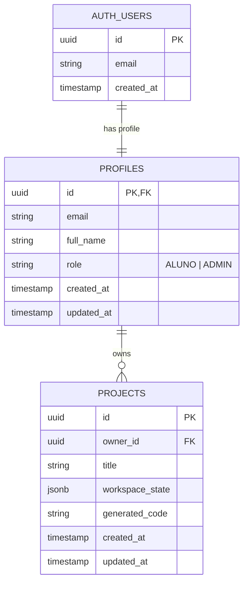

# Data Model: Code Blocks Arduino Platform (MVP)

**Feature**: [spec.md](file:///home/lucas/code-blocks-arduino/specs/001-code-blocks-arduino/spec.md) | **Date**: 2026-09-19

This document defines the data architecture, entity relationships, validation schemas, and database security policies for Code Blocks Arduino.

---

## 1. Entity-Relationship Diagram



---

## 2. Entities & Schema Definitions

### 2.1 Profile (`profiles`)
Extends Supabase `auth.users` with application-specific metadata and role-based access control.

| Field | Type | Nullable | Default | Description |
| :--- | :--- | :--- | :--- | :--- |
| `id` | `UUID` | No | `auth.uid()` | Primary key referencing `auth.users.id` (ON DELETE CASCADE) |
| `email` | `VARCHAR(255)` | No | - | E-mail registered via Google OAuth |
| `full_name` | `VARCHAR(255)` | Yes | `NULL` | Name extracted from Google user metadata |
| `role` | `VARCHAR(20)` | No | `'ALUNO'` | Access role: `'ALUNO'` or `'ADMIN'` |
| `created_at` | `TIMESTAMPTZ` | No | `NOW()` | Registration timestamp |
| `updated_at` | `TIMESTAMPTZ` | No | `NOW()` | Last update timestamp |

**Validation Rules:**
- `email`: Valid e-mail format, unique.
- `role`: Must strictly be one of `['ALUNO', 'ADMIN']`.

---

### 2.2 Project (`projects`)
Represents an individual student project containing visual blocks and metadata.

| Field | Type | Nullable | Default | Description |
| :--- | :--- | :--- | :--- | :--- |
| `id` | `UUID` | No | `gen_random_uuid()` | Unique project identifier |
| `owner_id` | `UUID` | No | `auth.uid()` | Foreign key referencing `profiles.id` (ON DELETE CASCADE) |
| `title` | `VARCHAR(100)` | No | `'Meu Projeto Arduino'` | Human-readable project title |
| `workspace_state` | `JSONB` | No | `'{"blocks":{"languageVersion":0,"blocks":[]}}'` | Serialized Google Blockly workspace (JSON format) |
| `generated_code` | `TEXT` | Yes | `''` | Cached/snapshot Arduino C/C++ generated code |
| `created_at` | `TIMESTAMPTZ` | No | `NOW()` | Creation timestamp |
| `updated_at` | `TIMESTAMPTZ` | No | `NOW()` | Last modification timestamp |

**Validation Rules:**
- `title`: Length between 1 and 100 characters, trimmed, no control characters.
- `workspace_state`: Must be valid JSON matching Blockly serialization structure.
- `owner_id`: Non-nullable, must match the authenticated user's ID upon creation.

---

## 3. Row Level Security (RLS) Policies

All tables MUST have Row Level Security enabled (`ALTER TABLE ... ENABLE ROW LEVEL SECURITY`).

### 3.1 `profiles` Table
- **Read (SELECT):**
  - Authenticated users can view their own profile: `auth.uid() = id`.
  - Admins can view all profiles: `EXISTS (SELECT 1 FROM profiles WHERE id = auth.uid() AND role = 'ADMIN')`.
- **Insert / Update:**
  - Automatic profile creation on first login via Supabase database trigger.
  - Updates to `role` are restricted exclusively to Admins.

### 3.2 `projects` Table
- **Read (SELECT):**
  - Students can read ONLY their own projects:
    ```sql
    auth.uid() = owner_id
    ```
- **Insert (INSERT):**
  - Authenticated users can create projects where they are the owner:
    ```sql
    auth.uid() = owner_id
    ```
- **Update (UPDATE):**
  - Users can update only their own projects:
    ```sql
    auth.uid() = owner_id
    ```
- **Delete (DELETE):**
  - Users can delete only their own projects:
    ```sql
    auth.uid() = owner_id
    ```

---

## 4. Lifecycle & State Transitions

### 4.1 Project State Lifecycle
```text
[Novo / Em Branco]
       ↓ (Aluno adiciona blocos no Workspace)
[Modificado no Cliente]
       ↓ (Clique em "Salvar Projeto")
[Persistido no Supabase]
       ├── (Edições subsequentes) ──> [Atualizado no Supabase]
       └── (Clique em "Excluir")   ──> [Excluído permanentemente]
```

1. **Initial / Unsaved**: Student enters Workspace, state is held in client memory via Blockly SVG workspace.
2. **First Save**: Student names project, payload is sent via API (`POST /api/projects`), creating a `projects` record.
3. **Continuous Save**: Auto-save or manual save triggers `PUT /api/projects/:id`, updating `workspace_state` and `updated_at`.
4. **Deletion**: Student confirms deletion in project list, issuing `DELETE /api/projects/:id`. RLS prevents cross-user deletion.
